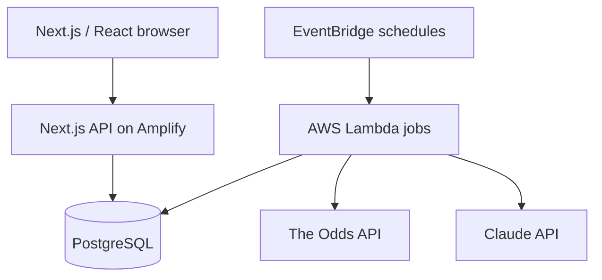

# RkVTk — V1 Product & Engineering Blueprint

*Working design reference · 2 November 2026 · design stage (not a deployed product)*

## 1. Product concept

RkVTk is a free-to-play, social NFL pick tracker for a small circle of friends. Users authenticate with a third-party identity provider, receive a **10-unit allowance each week**, and post simulated singles or parlays using bookmaker odds. Each ticket is recorded, settled against actual game results, and shown on social profiles and leaderboards. An AI feature narrates objectively computed agreement and disagreement within the community.

**Why build it?** Beyond the real use case for Rod and TK, this project demonstrates backend correctness, third-party data ingestion, asynchronous jobs, relational modeling, AWS operations, and applied LLM integration. It should generate honest system-design stories for backend-leaning engineering interviews.

## 2. Agreed V1 scope

| Decision | V1 commitment |
|---|---|
| Sport | NFL only (`americanfootball_nfl`) |
| Markets | Pregame moneylines, spreads, totals |
| Parlays | Cross-game only; no same-game or correlated legs |
| Odds sources | DraftKings and FanDuel comparison via The Odds API |
| Wagers | Virtual units only, no deposits, withdrawals or actual betting |
| Identity | Third-party Google sign-in via Cognito |
| Social | Follow friends, view tickets and results, weekly leaderboard |
| AI | Claude writes a short blurb about SQL-derived consensus |
| Settlement | Scheduled final NFL score ingestion and deterministic grading |

**Out of scope:** player props, live/in-play placing, same-game parlays, real sportsbook orders, notifications, mobile native app, public gambling marketplace, payments and microservices.

## 3. Suggested product rules

These defaults are deliberately precise so implementation and test expectations stay consistent.

1. A weekly period runs Monday 00:00 through the next Monday 00:00 in `America/New_York`, including DST transitions.
2. Each user starts with **10.0u available**, commits stakes in increments of **0.1u**, and can never commit more than 10.0u in one week.
3. Winnings and pushes do **not** restore this week's spending allowance. No unused-unit rollover.
4. A ticket belongs to the week it was **placed**, even if a Monday Night Football result or a correction settles later. That week's P&L remains provisional while tickets are pending.
5. Accepted odds are locked permanently at placement. The UI must show when a quote was last observed; placement fails or requests confirmation if it has moved or gone stale.
6. One parlay ticket uses quotes from a **single chosen bookmaker** and contains legs from distinct games. Its price is the product of decimal leg prices, explicitly described as a **simulated** parlay price rather than an executable DK/FD parlay quote.
7. A losing leg loses the parlay; a pending leg normally keeps it open; pushed or voided legs contribute 1.0x to price; an entirely pushed/voided ticket returns stake.
8. Use final game scores, including overtime where included in the official reported result. Abandoned/postponed/ambiguous games go to review or a documented voiding rule.
9. Start as a small invitation-only product; signed-in users can see participating users' picks and records. Revisit visibility before wider release.
10. Consensus means **distinct users** agreeing on exactly the same event, market, selection and line, with a separate aggregate of committed units. More tickets by one user do not artificially make a pick more popular.

## 4. Recommended stack and responsibilities

| Layer | Choice | Reason |
|---|---|---|
| UI/server HTTP | Next.js 15 App Router, React, TypeScript | One deployable full-stack application, familiar stack |
| Hosting | AWS Amplify Hosting | Git-based deployment and managed Next.js SSR |
| OAuth | AWS Amplify Gen 2 / Cognito + Google | Managed identity, access token validation |
| SQL | PostgreSQL with Drizzle ORM | Strong transactions and visible modeling |
| Database host | Neon at first | Economical development; migrate to RDS if justified |
| Odds/scores | The Odds API behind a provider interface | DK/FD aggregation, NHL/NBA excluded, normalized NFL data |
| Background jobs | EventBridge Scheduler → Lambda | Durable odds sync, grading, consensus jobs |
| LLM | Claude Haiku via server-only API | Low-budget textual synthesis from computed stats |
| Social freshness | 5–10s browser-to-app polling | Simple V1; no immediate WebSocket operational cost |

**Compatibility note:** AWS currently documents managed Amplify SSR support through Next.js 15. Next.js 15 is maintenance LTS through January 2027. Pin a patched compatible version and revisit before release. Official references: https://docs.aws.amazon.com/amplify/latest/userguide/ssr-amplify-support.html and https://nextjs.org/support-policy.

## 5. System overview



- Browser requests for odds read **our database cache**, not the upstream provider directly.
- A shared worker polls markets based on NFL schedules and quota budget; every quote retains event ID, bookmaker, market, selection, line, price, and observed timestamp.
- A different job ingests final scores and grades existing tickets. It can be retried after outages without double-crediting winnings.
- Consensus numbers come from SQL. Claude only describes the aggregate, with the computed figures and provenance preserved.

## 6. Data model (initial)

| Entity | Important fields / invariants |
|---|---|
| `users` | `id`, unique Cognito `sub`, unique handle, display name |
| `follows` | follower ID, followed ID, unique pair; no self follow |
| `weekly_allocations` | user ID + Eastern week start unique, committed tenths 0–100 |
| `events` | provider event ID, NFL teams, kickoff, lifecycle status, final score/version |
| `odds_snapshots` | event ID, DK/FD, market, selection, point, price, observed time |
| `wagers` | user/week, stake, type, idempotency key, locked combined odds, status, net P&L |
| `wager_legs` | wager/event, bookmaker, locked market/point/price, individual grade |
| `settlement_events` | append-only grading/void/correction audit records |
| `consensus_summaries` | week, input-data hash, structured counts, model, generated text |

**Key modeling insight:** A wager is an aggregate of one or more legs. Every leg is graded independently. The ticket's settlement state is derived deterministically from its leg states.

## 7. Core backend workflows

### A. Atomic wager placement

1. User selects cached NFL quotes and a stake; browser sends `quoteId`s, `stakeTenths`, and unique `idempotencyKey`.
2. API authenticates server-side, resolves user ID, validates pregame status, supported markets, quote freshness and cross-game parlay rules.
3. API reads the current quote from its trusted data store. Client-provided prices are ignored.
4. In **one SQL transaction**, resolve the user/week allocation and verify the idempotency key.
5. Commit the stake with a conditional DB update only if `committed_tenths + stake_tenths <= 100`; insert wager and locked legs in the same transaction.
6. On a concurrent over-budget attempt, reject one request. On retry with the same idempotency key, return the original wager without spending again.

**Test to write first:** With 10u remaining, two simultaneous requests for 6u must yield one success, one failure, and exactly 6u committed—never 12u.

### B. Settlement and correction

1. Scheduled worker pulls recently completed NFL games, including final scores (provider score endpoint exposes at most three days of completed games).
2. Persist an observation/result version; grade eligible h2h/spread/total legs using pure functions.
3. Recompute affected single/parlay ticket status and net units. Append an audit event for each transition.
4. A repeated job or duplicate provider response produces no additional payout.
5. If the final score is corrected, record the correction and recompute the affected tickets and historical leaderboard P&L exactly once.

**Test to write first:** Processing a finished game twice changes a ticket's net P&L once. A later score correction replaces the derived outcome and leaves an audit trail.

### C. Social and consensus

- Profile: handle, record, cumulative net units, ROI, open ticket count and ticket history.
- Feed: latest picks from followed users with server-side pagination and periodic UI refresh.
- Leaderboard: sum settled net units attributed to **placement week**; mark incomplete weeks provisional.
- Consensus: group picks by exact market selection; compute unique-user count, proportion and stake-weighted support. Use Claude to summarize only these computed facts. Cache by input hash or scheduled time.

## 8. API surface to design (not implemented)

| Endpoint | Intent |
|---|---|
| `GET /api/events` | Upcoming NFL games |
| `GET /api/events/:id/odds` | DK/FD price comparison with timestamps |
| `GET /api/me` | Identity and weekly allocation |
| `POST /api/wagers` | Trusted atomic placement with idempotency |
| `GET /api/me/wagers` | History and pending tickets |
| `GET /api/users/:handle` | Public-by-policy profile |
| `POST/DELETE /api/users/:handle/follow` | Follow graph changes |
| `GET /api/feed` | Paginated followed activity |
| `GET /api/leaderboard` | Weekly and all-time P&L |
| `GET /api/consensus` | Structured agreement and cached narrative |

Suggested placement request:

```json
{
  "idempotencyKey": "random-uuid",
  "stakeTenths": 15,
  "legs": [{ "quoteId": "quote-uuid-a" }, { "quoteId": "quote-uuid-b" }]
}
```

`15` tenths = 1.5 units. Do not accept a client-supplied `userId`, `acceptedPrice` or `weeklyRemaining` as authority.

## 9. API and operating constraints

- The Odds API exposes DraftKings/FanDuel and NFL market prices. Published plans at design time include 500 free credits/month and $30/month for 20,000 credits. Quota cost varies by requested markets/regions; check response headers and do not promise a specific refresh frequency without a budget. https://the-odds-api.com/
- Its score feed covers completed NFL scores, not the player-level stat truth needed for props; this is why props are not in V1. https://the-odds-api.com/liveapi/guides/v4/
- The provider's current terms allow use in an end-user app but prohibit resale/redistribution as a standalone raw odds feed. https://the-odds-api.com/terms-and-conditions.html
- Hide secrets in managed AWS environment, never in client bundles or Git. Handle `429`, outages, stale/removed markets, result corrections, and interrupted workers.
- WebSocket infrastructure, Kafka, Redis and microservices are not necessary for the small-circle MVP. Explain which observed scale problems would justify them later.
- For costs, watch odds credits, Amplify SSR compute/build, Lambda invocation, DB uptime and LLM calls. Set AWS budget alarms before deployment.

## 10. Development sequence — aimed at 10–15h/week

| Week | Primary deliverable | Must-pass check | Interview drill |
|---|---|---|---|
| 1 | Repo setup, domain types, schema, Google auth and profiles | Two accounts remain isolated | Auth token flow and SQL relationships |
| 2 | NFL odds provider adapter and quote cache | DK/FD fixture normalization; stale quote rejection | Cache/data-provider failure design |
| 3 | 10u allocation and transactional placement | Duplicate key + 6u race tests | Database concurrency and idempotency |
| 4 | Scheduled NFL final-score grading and parlays | Win/loss/push/void, retries, correction tests | State machines and eventual consistency |
| 5 | Following, feeds, profiles, rankings | Correct pagination; weekly P&L attribution | Feed design, indexing, read scaling |
| 6 | AI consensus, AWS jobs, monitoring, deployment | Deterministic counts; safe prompt; smoke tests | 45-minute end-to-end system design mock |

### The first 90-minute coding session

1. Initialize a fresh `rk-v-tk` repository, README, `.gitignore`, `AGENTS.md`, and docs. Do not reuse the Onyx repo or its secrets.
2. Choose Next.js 15/TypeScript, PostgreSQL/Drizzle, Amplify + Cognito. Create a minimal app and a health route.
3. Implement **pure functions first**: American→decimal odds, spread/total/moneyline grading, parlay push behavior, and Monday Eastern week boundaries.
4. Write fixtures/tests for those functions; then build the database schema. Do not start with a large dashboard or a production cloud deploy.

### Suggested system-design questions to practice

1. How does the server prevent 12u from being committed when two 6u tickets arrive concurrently?
2. What happens if the provider changes a spread while a user is confirming a ticket?
3. What if a settlement worker runs twice, crashes mid-transaction, or receives a corrected score?
4. How would you handle 10,000 people refreshing the odds page without spending 10,000 upstream API requests?
5. When would a 10-second polling feed stop being sufficient, and what would you migrate to?
6. Why should a model generate narrative but never calculate consensus or grade wager results?

## 11. Resume proof points to capture later

- Unit test counts and integration test coverage for placement/settlement.
- Number of users, simulated picks and providers actually supported.
- Successful concurrent-placement and idempotency tests.
- Measured odds cache hit rate/provider calls saved, or reduction in upstream traffic.
- Architecture diagram and an honest explanation of AWS hosting + background jobs.
- Clear readme tradeoffs: Postgres vs NoSQL, polling vs WebSockets, scheduled workers vs request-time work, and data correctness vs feature breadth.

Do **not** claim these outcomes as shipped until implemented and measured.
